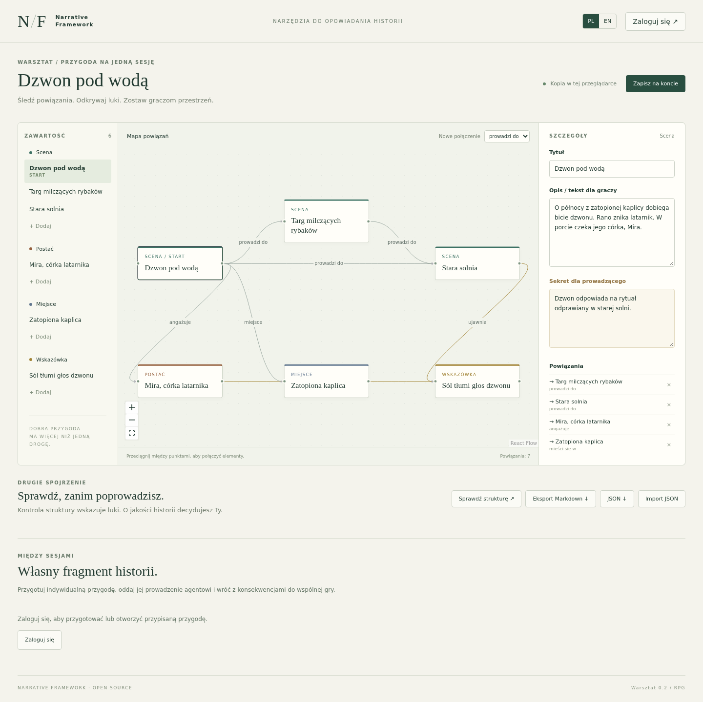

# Narrative Framework

[Polski](README.pl.md) · [Try the workshop](https://app.narrativeframework.com/workshop/) · [Website](https://narrativeframework.com) · [Support development](https://www.buymeacoffee.com/StolemCentrumGier)

An open-source RPG adventure workshop: connect scenes, characters, places and clues, keep campaign lore in a wiki, and prepare individual downtime, solo or absent-character adventures for an external MCP agent.

**Current preview: `v0.3.0-alpha.2`.** This is working software under active development. Campaign owners can invite co-GMs and players, then publish to the whole group or selected members. Functional test results are not a server-capacity guarantee.



## What works

- A visual adventure editor, structural checks and separate GM secrets.
- Campaign session view, timeline, NPC/player character sheets and world material in separate views. Numeric stats, conditions and consequences use a deterministic Python port of the MIT-licensed Unity narrative core; preview real changes before saving a decision.
- Campaign memberships/invitations, draft/publication separation, selected audiences, GM preview and filtered Markdown/search/relationships/map.
- Explicit, version-checked wiki copies into multiple adventures.
- GM-assigned downtime/solo adventures, scoped player MCP access, persistent memory/journal and human review of lasting consequences.
- Data-driven character creation for any RPG system: the GM uploads a rules pack (stats, skills, formulas, pools such as humanity, a gear/cyberware catalog with prices, slots and requirements, random background tables, roles, creation methods); players build characters step by step with live point counters, server-side dice and a GM approval queue. Approved characters become wiki sheets and campaign-engine actors.
- Private campaign images: a GM gallery shared with players on demand, a campaign cover, page illustrations published with their page and pictures in character creation; click to enlarge. Images are re-encoded without metadata and never get public links.
- Per-campaign appearance (Fantasy or Cyberpunk theme) and page templates; one-file campaign template import.
- Separate author and player MCP catalogs; the author MCP covers the whole GM workflow (campaigns, pages, relations, publication, campaign engine, rules packs, character review, images). The server does not include its own AI model or chat client.
- English/Polish interface, account-free browser-local demo, private accounts and JSON/Markdown exports.
- Docker Compose with Django/DRF, PostgreSQL, Redis, React/TypeScript, React Flow and Caddy.

## Run locally

Requires Docker Engine and Docker Compose. From the repository root:

```sh
cp web/.env.example web/.env
```

Generate two separate secrets and put them in `web/.env` as `DJANGO_SECRET_KEY` and `POSTGRES_PASSWORD`:

```sh
python3 -c 'import secrets; print(secrets.token_urlsafe(48))'
```

Then start the stack:

```sh
docker compose -f web/compose.yaml up --build -d
```

Open **http://localhost:8080**. The workshop dashboard (new campaign, new adventure and saved material) is at `/workshop/`, the campaign workspace at `/campaigns/`. The example configuration enables signup. PostgreSQL persists in a Docker volume; `docker compose down -v` deletes that data. No AI provider key is needed to run the application or tests. An external agent/client is required for AI-led play.

Before public deployment, follow the [setup and HTTPS instructions](web/README.md), set your own hostnames, secure cookies and trusted proxy addresses, and arrange backups. Do not commit `.env`, tokens or real campaign data. The hosted test instance is separate from a self-hosted installation.

## Guides

| Topic | English | Polski |
| --- | --- | --- |
| Setup and operation | [Guide](web/README.md) | [Instrukcja](web/README.pl.md) |
| Running a campaign and character stats | [Guide](web/docs/narrative-runtime.md) | [Instrukcja](web/docs/pl/campaign-runtime.md) |
| Campaign wiki | [Guide](web/docs/en/campaign-wiki.md) | [Instrukcja](web/docs/pl/campaign-wiki.md) |
| Individual adventures | [Guide](web/docs/en/individual-play.md) | [Instrukcja](web/docs/pl/individual-play.md) |
| Player MCP contract | [Contract](web/docs/en/mcp-play.md) | [Kontrakt](web/docs/pl/mcp-play.md) |
| Character creation design (rules packs) | — | [Projekt](web/docs/design/kreator-postaci/01-koncepcja.md) |
| Campaign images and privacy rules | — | [Zasady](web/docs/design/obrazy-kampanii.md) |
| Reproduced failures | [Report](web/docs/en/adversarial-testing.md) | [Raport](web/docs/pl/adversarial-testing.md) |
| Campaign sharing design | [Design](web/docs/en/campaign-sharing-plan.md) | [Plan](web/docs/pl/campaign-sharing-plan.md) |

See [verification](web/docs/verification.md), [release notes](CHANGELOG.md), [contributing](CONTRIBUTING.md), [security reporting](SECURITY.md) and [third-party notices](THIRD_PARTY_NOTICES.md).

## Current boundaries

Kanka import, player wiki editing, player-uploaded images and a separate campaign-reader MCP are not implemented. Commercial rules packs and images stay private to their campaign and are not part of this repository. The existing player endpoint uses explicitly assigned adventure snapshots. Outside character creation (which validates a campaign's rules pack) the server does not enforce RPG mechanics during play; it does not guarantee narrative quality, automatically merge consequences into campaign canon, provide email/password-reset automation or support realtime collaborative editing. Browser wiki sharing is available; the sharing design records subsequent stages.

## Where it started

Narrative Framework began as a Unity toolkit for branching narrative simulations. As its game-focused use evolved, this independently hosted RPG workshop became the public open-source direction. The original code remains in [`Assets/NarrativeFrameworkForUnity`](Assets/NarrativeFrameworkForUnity/Documentation/README.md) as the Unity implementation. The web application now uses a documented [Python port of its deterministic core](web/docs/narrative-runtime.md), tested separately from Unity. Running the web app does not require the Unity editor; the original Unity implementation was not validated by the web release tests. Its JSON format is separate, with no Unity/web conversion promise. Unity setup: [quick start](Assets/NarrativeFrameworkForUnity/Documentation/QUICK_START.md).

## License and support

Code and documentation use the [MIT License](LICENSE). [Brand-name/logo permissions](BRANDING.md) are documented separately. AI-generated demo illustrations are provided as-is; see [asset and dependency notices](THIRD_PARTY_NOTICES.md).

If the project helps your table, you can support it through [Buy Me a Coffee — Oil to my machine](https://www.buymeacoffee.com/StolemCentrumGier).


- [First campaign / Pierwsza kampania — UX](web/docs/en/first-campaign-ux.md)
- [Blog, SEO, Analytics](web/docs/en/publishing-and-analytics.md)
