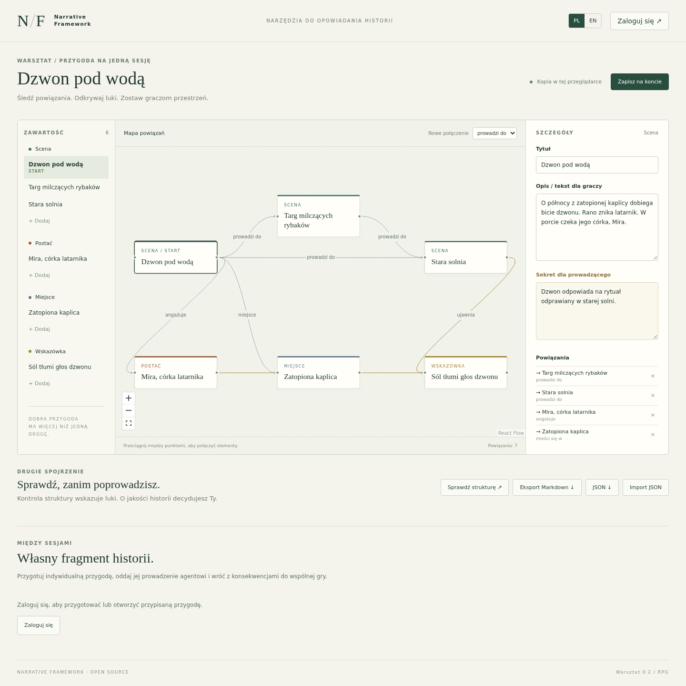

# Narrative Framework

[English](README.md) · [Wypróbuj warsztat](https://app.narrativeframework.com/workshop/) · [Strona projektu](https://narrativeframework.com) · [Wesprzyj rozwój](https://www.buymeacoffee.com/StolemCentrumGier)

Otwarty warsztat RPG: wizualne przygotowanie przygód, wiki świata kampanii i indywidualne przygody downtime, solo lub dla nieobecnej postaci prowadzone przez zewnętrznego agenta MCP.

**Bieżąca wersja testowa: `v0.3.0-alpha.2`.** Wiki obsługuje zaproszenia, role współ-MG/gracza i publikacje dla całej grupy lub wybranych osób. Wyniki testów funkcjonalnych nie oznaczają gwarantowanej liczby użytkowników.



## Co działa

- Graf scen, postaci, miejsc i wskazówek; kontrola struktury i osobne sekrety MG.
- Wiki Markdown z członkostwem kampanii, oddzielnymi szkicami/publikacjami, podglądem MG jako gracz i filtrowanymi relacjami, wyszukiwaniem oraz mapą.
- Kopiowanie wersjonowanych materiałów wiki do wielu przygód.
- Przydzielanie indywidualnych przygód, pamięć i dziennik gracza oraz zatwierdzanie konsekwencji przez MG.
- Osobne MCP autora i gracza; serwer nie zawiera własnego modelu ani czatu AI.
- PL/EN, lokalne demo bez konta, prywatne konta, eksport JSON/Markdown.
- Docker Compose: Django/DRF, PostgreSQL, Redis, React/TypeScript, React Flow i Caddy.

## Uruchomienie

Potrzebujesz Docker Engine i Docker Compose. W katalogu repozytorium:

```sh
cp web/.env.example web/.env
```

Wygeneruj dwa osobne sekrety i wpisz do `web/.env` jako `DJANGO_SECRET_KEY` i `POSTGRES_PASSWORD`:

```sh
python3 -c 'import secrets; print(secrets.token_urlsafe(48))'
```

Uruchom:

```sh
docker compose -f web/compose.yaml up --build -d
```

Strona: **http://localhost:8080**, edytor: `/workshop/`, wiki: `/campaigns/`. Przykładowa konfiguracja pozwala zakładać konta. Baza pozostaje w wolumenie Dockera; `docker compose down -v` usuwa dane. Do uruchomienia i testów nie potrzeba klucza dostawcy AI. Rozgrywka z AI wymaga zewnętrznego klienta/agenta MCP.

Przed wystawieniem do Internetu przeczytaj [instrukcję instalacji i HTTPS](web/README.pl.md), ustaw własne hosty, bezpieczne cookies i zaufane proxy oraz przygotuj kopie zapasowe. Nie dodawaj `.env`, tokenów ani prawdziwych materiałów kampanii do Gita. Publiczna instancja testowa jest oddzielna od Twojej instalacji.

## Dokumentacja i ograniczenia

- [Wiki kampanii](web/docs/pl/campaign-wiki.md).
- [Przygody indywidualne](web/docs/pl/individual-play.md) i [kontrakt MCP gracza](web/docs/pl/mcp-play.md).
- [Plan udostępniania kampanii grupie](web/docs/pl/campaign-sharing-plan.md) — etapy 1–2 są wdrożone; osobne MCP czytelnika pozostaje kolejnym etapem.
- [Testy odporności](web/docs/pl/adversarial-testing.md), [wyniki weryfikacji](web/docs/verification.md), [historia wydania](CHANGELOG.md).
- [Współtworzenie](CONTRIBUTING.md), [zgłaszanie podatności](SECURITY.md), [zależności i materiały](THIRD_PARTY_NOTICES.md).

Nie ma jeszcze importu z Kanki, MCP czytelnika kampanii, edycji w czasie rzeczywistym ani automatycznego resetu hasła/e-maili. MCP gracza korzysta z jawnie przydzielonych migawek przygody. Serwer nie pilnuje mechaniki RPG, nie gwarantuje jakości narracji i nie scala automatycznie konsekwencji z kanonem kampanii.

## Początki i licencja

Projekt zaczął się jako framework narracyjny do Unity. Później rozwinął się w kierunku wykorzystania w grze, a ten otwarty warsztat RPG stał się niezależną wersją dla wszystkich. Oryginalne [assety Unity](Assets/NarrativeFrameworkForUnity/Documentation/README.md) pozostają częścią historyczną; aplikacja webowa ich nie potrzebuje. Nie były sprawdzane testami wydania webowego i mają inny format danych, bez gotowej konwersji.

Kod i dokumentacja: [MIT](LICENSE), z osobno opisanymi [zasadami używania marki](BRANDING.md). Ilustracje demonstracyjne wygenerowano z pomocą AI i udostępniono bez gwarancji; szczegóły w [informacji o materiałach](THIRD_PARTY_NOTICES.md).

Wsparcie: [Buy Me a Coffee — Oil to my machine](https://www.buymeacoffee.com/StolemCentrumGier).
